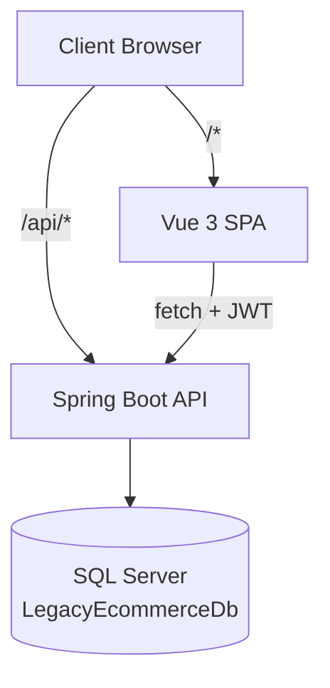

# RAW.FORM — eCommerce

> A full-stack eCommerce application built with **Java 21 + Spring Boot 3.3** and **Vue 3**.

## Overview

RAW.FORM is a production-ready eCommerce platform with a stateless Spring Boot backend, a Vue 3 SPA frontend, and SQL Server storage. It provides product catalog browsing, cart management, JWT-authenticated checkout, and order management.

## Features

- **Authentication** — JWT Bearer (HS256), login/register, token persistence, expiry handling
- **Product Catalog** — Browse, search, filter, sort, paginate, hierarchical category tree
- **Product Detail** — Image gallery with thumbnails, variant selector, stock display, price adjustment
- **Shopping Cart** — Add, remove, update quantity, persistent per-customer cart, auth-gated
- **Checkout** — 5-step wizard: Address → Shipping Method → Payment → Review → Confirm
- **Shipping Options** — Standard (₹99) and Express (₹199) with GST (18%) tax calculation
- **Mock Payment** — Card form with client-side validation (16-digit card, MM/YY expiry, 3-4 digit CVV)
- **Order Management** — Order history, order detail, order confirmation, idempotent order placement
- **Account** — Profile view, account dashboard, user menu with auth-aware footer links
- **Currency** — Indian Rupees (₹) via `Intl.NumberFormat('en-IN')` shared formatter

## Architecture



### Backend — Java 21 + Spring Boot 3.3

```
src/backend/
├── src/main/java/com/ecommerce/
│   ├── controller/         ← REST controllers (products, cart, auth, orders, checkout)
│   ├── service/             ← Business logic (ProductService, CartService, OrderService, etc.)
│   ├── repository/          ← Spring Data JPA + JdbcTemplate custom queries
│   ├── domain/              ← JPA entities (Customer, Product, Order, etc.)
│   ├── dto/                 ← Request/response records
│   ├── security/            ← JWT generation, validation, JwtAuthFilter
│   └── config/              ← SecurityConfig, DataSeeder (test only)
├── src/main/resources/
│   ├── application.yml      ← SQL Server default config
│   ├── application-dev.yml  ← Dev profile (SQL Server, SQL logging)
│   ├── application-test.yml ← Test profile (H2 in-memory, seed data)
│   ├── application-prod.yml ← Prod profile (SQL Server + Flyway)
│   └── db/migration/        ← Flyway baseline schema
├── src/test/java/           ← JUnit 5 + MockMvc + Mockito tests
├── Dockerfile
└── pom.xml
```

### Technology Stack

| Layer | Technology | Version |
|-------|-----------|---------|
| Backend | Java 21 + Spring Boot | 3.3.x |
| Frontend | Vue.js 3 (Composition API) | 3.5.x |
| Build (FE) | Vite | 8.x |
| State (FE) | Pinia | 4.x |
| Router (FE) | Vue Router | 5.x |
| Database | SQL Server | 2022+ |
| Data Access | Spring Data JPA + JdbcTemplate | — |
| Auth | JWT Bearer (HS256) | — |
| Testing (BE) | JUnit 5 + MockMvc + Mockito | — |
| Testing (FE) | Vitest + Vue Test Utils | — |
| Testing (E2E) | Playwright | — |
| API Docs | OpenAPI (springdoc) | 2.6.x |

## Folder Structure

```
ecommerce/
├── .github/              ← CI/CD workflows, PR templates, dependabot
├── docker/               ← Docker Compose stack
│   └── compose/
│       └── docker-compose.yml
├── docs/                 ← All project documentation
│   ├── api/              ← Endpoint catalog, OpenAPI spec
│   ├── architecture/     ← Architecture, data flow, auth, deployment
│   ├── decisions/        ← Architecture Decision Records (ADRs)
│   ├── migration/         ← Historical migration documentation
│   ├── reference/        ← Legacy codebase notes, prompt library
│   └── runbooks/         ← Setup, seeding, incident, rollback guides
├── src/
│   ├── backend/          ← Java 21 + Spring Boot 3.3 backend
│   └── frontend/         ← Vue 3 SPA (Vite + Pinia + Vue Router)
├── tests/                ← E2E tests (Playwright)
└── Makefile              ← Common commands
```

## Prerequisites

| Tool | Version | Purpose |
|------|---------|---------|
| [JDK](https://adoptium.net/) | 21+ | Spring Boot backend, tests |
| [Maven](https://maven.apache.org/) | 3.9+ | Java build, dependency resolution |
| [Node.js](https://nodejs.org/) | 22+ | Frontend SPA, E2E tests |
| [npm](https://www.npmjs.com/) | 10+ | Package management |
| [Docker](https://www.docker.com/) | — | SQL Server, containerized deployment |
| [Git](https://git-scm.com/) | 2.x | Version control |

## Local Setup

### Database (SQL Server via Docker)

```bash
docker run -d --name sqlserver \
  -e "ACCEPT_EULA=Y" \
  -e "MSSQL_SA_PASSWORD=YourStrong@Passw0rd" \
  -p 1433:1433 \
  mcr.microsoft.com/mssql/server:2022-latest
```

Create the database and schema (run once):

```bash
# Connect and run the baseline migration script
docker exec -i sqlserver /opt/mssql-tools18/bin/sqlcmd -S localhost -U sa -P "YourStrong@Passw0rd" -C \
  -d master -Q "CREATE DATABASE LegacyEcommerceDb"

docker exec -i sqlserver /opt/mssql-tools18/bin/sqlcmd -S localhost -U sa -P "YourStrong@Passw0rd" -C \
  -d LegacyEcommerceDb -i src/backend/src/main/resources/db/migration/V1__baseline.sql
```

### Backend (Spring Boot)

```bash
cd src/backend

# Build + test
mvn clean package -B

# Run the API (connects to SQL Server on localhost:1433)
mvn spring-boot:run

# API available at http://localhost:5001
# Swagger UI at http://localhost:5001/swagger-ui.html
```

### Frontend

```bash
cd src/frontend/spa

# Install dependencies
npm install

# Start dev server (Vite, port 5174 by default)
npm run dev
```

## Running the Application

```bash
# Terminal 1: Backend API
cd src/backend
mvn spring-boot:run

# Terminal 2: Frontend SPA
cd src/frontend/spa
npm run dev
```

## Running Tests

### Backend Tests (JUnit 5)

```bash
cd src/backend

# Run all tests (uses H2 in-memory DB with seed data)
mvn test -B

# Run a specific test class
mvn test -Dtest=JwtTokenServiceTest
```

### Frontend Tests (Vitest)

```bash
cd src/frontend/spa
npx vitest run
```

### E2E Tests (Playwright)

```bash
cd tests/e2e
npm install
npx playwright test
```

## Docker

```bash
# Build and run the full stack (API + SPA + SQL Server)
docker compose -f docker/compose/docker-compose.yml up -d

# Stop
docker compose -f docker/compose/docker-compose.yml down
```

## Makefile Shortcuts

```bash
make build         # Build backend + frontend
make test          # Run backend + frontend tests
make test-e2e      # Run Playwright E2E tests
make lint          # Type check frontend
make docker-up     # Start all services via Docker Compose
make verify        # Full CI verification (builds + tests)
make clean         # Remove build artifacts
```

## Architecture Overview

The application follows a **layered architecture** with clear separation of concerns:

### Spring Boot Backend

- **Controllers** (`com.ecommerce.controller/`) — HTTP endpoints, model validation, JWT claim extraction
- **Services** (`com.ecommerce.service/`) — Business logic, orchestration, validation
- **Repositories** (`com.ecommerce.repository/`) — Spring Data JPA + `NamedParameterJdbcTemplate` for custom queries
- **Domain** (`com.ecommerce.domain/`) — JPA entities (`Customer`, `Product`, `Order`, etc.)
- **DTOs** (`com.ecommerce.dto/`) — Request/response records
- **Security** (`com.ecommerce.security/`) — JWT token generation, validation, `JwtAuthFilter`
- **Config** (`com.ecommerce.config/`) — `SecurityConfig`, `DataSeeder` (test profile only)

The SPA uses **Pinia stores** for state management, **Vue Router** for navigation, and a shared **`fetch` wrapper** (`api/client.ts`) that handles JWT attachment and error propagation.

## Documentation

All documentation lives under [`docs/`](docs/). See the [Documentation Index](docs/README.md) for a complete map.

### Key Documents

| Category | Document | Description |
|----------|----------|-------------|
| Architecture | [Architecture Overview](docs/architecture/README.md) | Topology, tech stack, request lifecycle |
| Decisions | [ADR Index](docs/decisions/README.md) | Architecture decision records |
| API | [Endpoint Catalog](docs/api/endpoint-catalog.md) | All REST endpoints |
| API | [OpenAPI Spec](docs/api/openapi.yaml) | Machine-readable spec |
| Runbooks | [Spring Setup](docs/runbooks/spring-setup.md) | Backend setup guide |
| Runbooks | [Local Setup](docs/runbooks/local-setup.md) | Environment setup guide |
| Runbooks | [Incident Response](docs/runbooks/incident-response.md) | Production incident guide |
| Reference | [Legacy Codebase Notes](docs/reference/legacy-codebase-notes.md) | Historical migration notes |

## License

See [LICENSE](LICENSE).