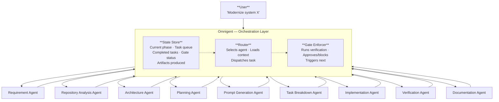
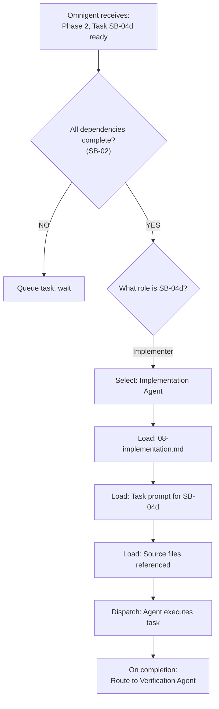
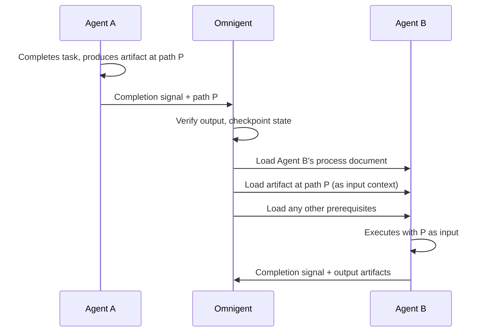
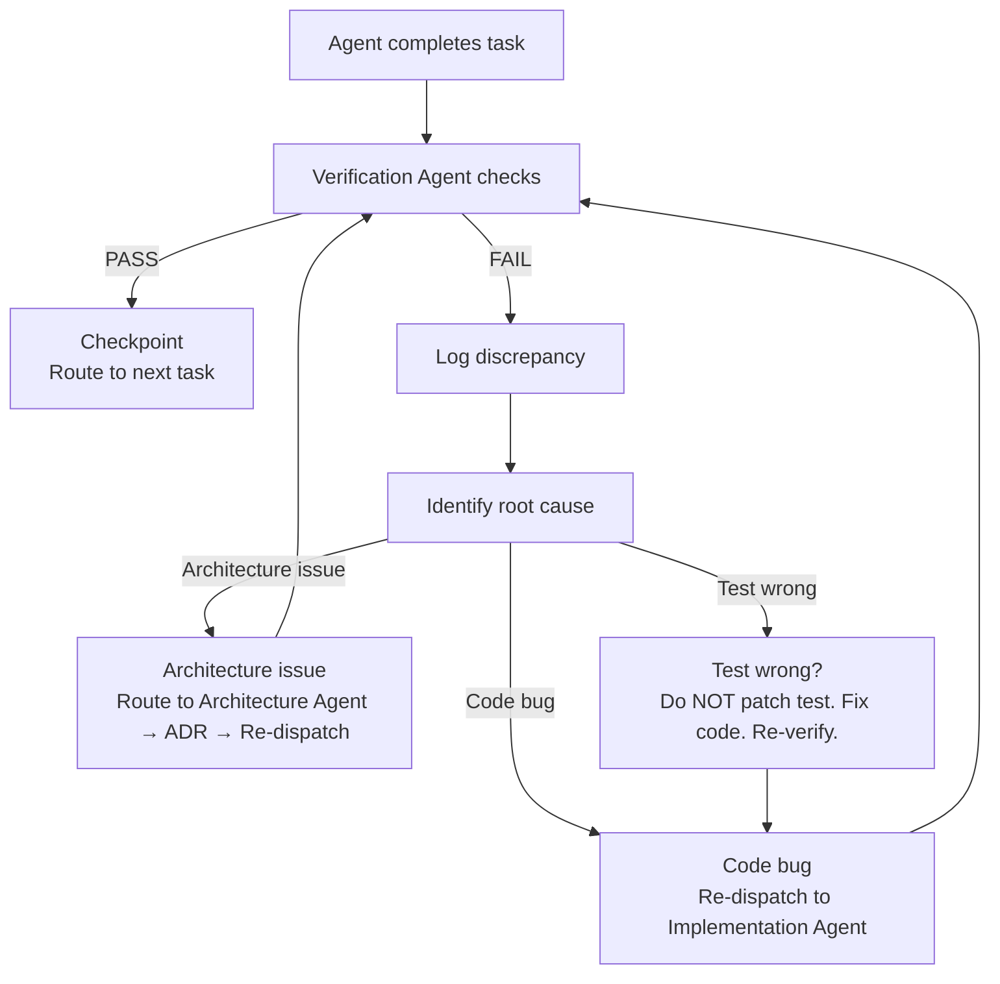
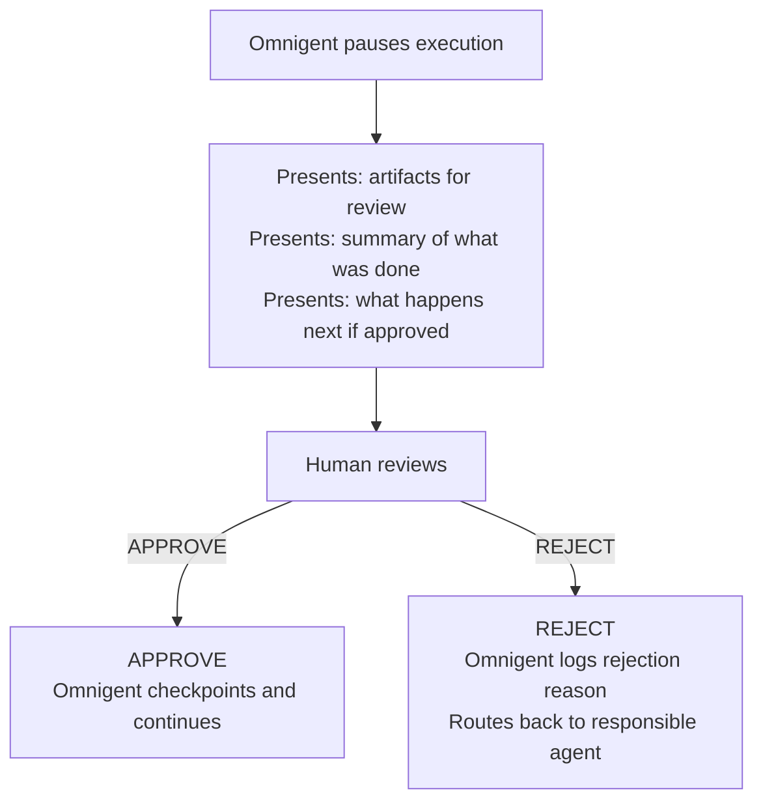
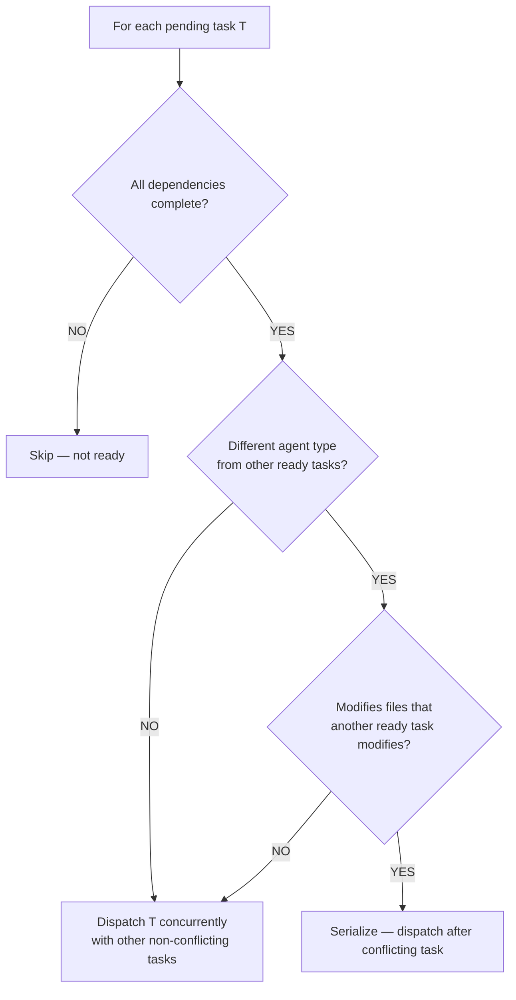

# Omnigent Orchestration

**How Omnigent coordinates AI agents through the modular POC development methodology.**

---

## 1. Purpose

Omnigent is the orchestration layer that routes work between specialized AI agents, manages state, enforces gates, and delivers a finished product from a user requirement. It uses the modular process documents in `docs/process/` as the instruction set for each agent.

This document is generic and applies to any AI-assisted POC or modernization project, not just the .NET-to-Java case study.

---

## 2. Overall Orchestration Architecture



---

## 3. Why the Methodology Was Split into Multiple Process Documents

A single monolithic methodology document (the original was ~980 lines) is too large for an AI agent to consume efficiently. When an agent is implementing a single task, it does not need to read about progress tracking, documentation strategy, or final delivery procedures. Loading irrelevant context wastes token budget, dilutes attention, and increases the risk of the agent following instructions from the wrong phase.

The modular split solves three problems:

| Problem | Monolithic Doc | Modular Docs |
|---------|---------------|-------------|
| Context window pressure | Agent loads 980 lines, uses 50 | Agent loads 60-115 lines, uses all |
| Instruction bleed | Agent may follow planning rules during implementation | Agent only sees implementation rules |
| Maintainability | One change can break unrelated sections | Each doc changes independently |

Each process document is self-contained, focused on a single responsibility, and sized for a single agent context load (59-165 lines).

---

## 4. Context-Loading Strategy

Omnigent loads only the process documents relevant to the current agent's task. No agent receives the full methodology.

### Rules

1. **One process doc per agent per task.** The agent reads the document that defines its responsibility, plus the artifacts produced by upstream agents.
2. **Artifacts are passed as files, not summarized.** When the Requirement Agent produces a Repository Understanding Document, the Repository Analysis Agent receives the file path, not a summary. This preserves fidelity.
3. **Prerequisites are enforced.** Each process document declares its prerequisites. Omnigent checks that prerequisite artifacts exist before dispatching the agent.
4. **No speculative loading.** An agent never loads a process document for a phase it is not executing.

### Context Budget

| Agent | Process Doc Loaded | Upstream Artifacts Loaded | Approx. Context |
|-------|-------------------|--------------------------|-----------------|
| Requirement | `01-requirement-understanding.md` | Source repository | 60 lines + source |
| Repository Analysis | `02-repository-analysis.md` | Repository Understanding doc | 71 lines + doc |
| Architecture | `03-architecture-understanding.md` | Repository Understanding doc | 84 lines + doc |
| Planning | `04-planning.md` | Architecture docs + ADRs | 94 lines + docs |
| Task Breakdown | `05-task-breakdown.md` | Planning artifacts | 101 lines + artifacts |
| Prompt Generation | `07-prompt-generation.md` | Task list + parity traps | 115 lines + tasks |
| Implementation | `08-implementation.md` | Task prompt + source code | 59 lines + prompt + source |
| Verification | `09-build-and-verification.md` | Test results + gate criteria | 81 lines + results |
| Documentation | `10-documentation.md` | All artifacts produced so far | 60 lines + artifacts |

---

## 5. Agent Responsibilities

### Requirement Agent

Reads the existing source codebase and catalogs all behaviors, data contracts, and parity traps. Produces the Repository Understanding Document.

### Repository Analysis Agent

Performs layered bottom-up analysis of the source code (data access → models → services → controllers → config → tests → build). Reverse-engineers database schema from SQL queries. Produces structured catalogs and a Flyway baseline script.

### Architecture Agent

Documents current-state and target-state architecture. Authors ADRs for each significant decision. Produces architecture documents and ADR files.

### Planning Agent

Produces 10 planning artifacts: migration summary, implementation plan, migration phases, task breakdown, task dependencies, AI role assignment, task prompts, verification strategy, documentation strategy. Defines phase gates with automated criteria.

### Task Breakdown Agent

Decomposes phases into single-objective tasks with stable IDs, explicit dependencies, binary acceptance criteria, and file-level granularity. Identifies the critical path and parallelization opportunities.

### Prompt Generation Agent

Builds self-contained prompts for each task: a shared preamble (parity constraints, coding conventions, report format) plus a task-specific section (source files, output files, acceptance criteria, build commands).

### Implementation Agent

Reads the task prompt and source code, writes new code following preamble conventions, runs build and test commands, fixes errors in a build-test-fix loop until both pass. Reports files, command output, and deviations considered but not made.

### Verification Agent

Runs the three verification rings (unit, integration, parity). Executes phase gate checks. Performs end-to-end smoke tests against the target database. Approves or blocks phase transitions.

### Documentation Agent

Updates documentation in lockstep with code changes. Rewrites README as a native project. Marks migration docs as historical archive. Produces runbooks, parity checklists, and migration reports.

---

## 6. Process Document Access Matrix

Each agent is allowed to load only the process documents it needs:

| Agent | Primary Doc | May Also Reference |
|-------|------------|-------------------|
| Requirement | `01-requirement-understanding.md` | `00-overview.md` |
| Repository Analysis | `02-repository-analysis.md` | `01-requirement-understanding.md` |
| Architecture | `03-architecture-understanding.md` | `02-repository-analysis.md` |
| Planning | `04-planning.md` | `03-architecture-understanding.md` |
| Task Breakdown | `05-task-breakdown.md` | `04-planning.md` |
| Prompt Generation | `07-prompt-generation.md` | `01-requirement-understanding.md`, `05-task-breakdown.md` |
| Implementation | `08-implementation.md` | `07-prompt-generation.md` (the prompt itself) |
| Verification | `09-build-and-verification.md` | `04-planning.md` (gate definitions) |
| Documentation | `10-documentation.md` | `12-final-delivery.md` |
| Orchestrator | `06-agent-orchestration.md` | `00-overview.md`, `11-progress-tracking.md` |

Agents must not load process documents outside their access matrix. This prevents instruction bleed — an implementation agent following planning rules, or a verification agent making architectural decisions.

---

## 7. Input and Output of Every Agent

| Agent | Input | Output |
|-------|-------|--------|
| Requirement | Source repository path | Repository Understanding Document, parity trap register |
| Repository Analysis | Repository Understanding Document, source code | Layer catalogs, Flyway baseline script, schema document |
| Architecture | Repository Understanding Document, catalogs | Current-state doc, target-state doc, ADR files |
| Planning | Architecture docs, ADRs | 10 planning artifacts (phases, tasks, dependencies, prompts, verification strategy, documentation strategy) |
| Task Breakdown | Planning artifacts (phases + roles) | Master task list with stable IDs, dependency graph, critical path |
| Prompt Generation | Master task list, parity trap register | One self-contained prompt per task (preamble + task section) |
| Implementation | Task prompt, source code | New/modified source files, build output, test output, completion report |
| Verification | Test results, gate criteria, running app | Gate decision (PASS/FAIL), verification report, discrepancy log |
| Documentation | All artifacts produced so far | Updated README, runbooks, parity checklist, migration report, archived migration docs |

---

## 8. How Omnigent Routes Work Between Agents

Omnigent uses a phase-driven routing model. The current phase determines which agents are active. Within a phase, task dependencies determine the dispatch order.

### Routing Rules

1. **Sequential phases.** Phase N+1 does not begin until Phase N's gate passes.
2. **Dependency-ordered dispatch within a phase.** A task is only dispatched when all its declared dependencies are complete.
3. **Parallel dispatch where the dependency graph allows.** Independent tasks within a phase are dispatched concurrently.
4. **Agent selection by task type.** Each task has a role assignment (see `06-agent-orchestration.md`). Omnigent maps the role to the appropriate agent.
5. **Gate enforcement between phases.** The Verification Agent runs gate checks. Omnigent blocks phase transitions on gate failure.

### Routing Decision



---

## 9. Context Handoff Between Agents

Agents do not communicate directly. Omnigent mediates all handoffs by passing artifact file paths.

### Handoff Protocol



### What Is Handed Off

| From → To | Artifact |
|-----------|----------|
| Requirement → Repository Analysis | Repository Understanding Document |
| Repository Analysis → Architecture | Layer catalogs + schema document |
| Architecture → Planning | Architecture docs + ADRs |
| Planning → Task Breakdown | Phase definitions + role assignments |
| Task Breakdown → Prompt Generation | Master task list + dependency graph |
| Prompt Generation → Implementation | One task prompt |
| Implementation → Verification | Build output + test results + completion report |
| Verification → Documentation | Gate decision + verification report |
| Verification → Implementation (on fail) | Discrepancy log + re-execute instruction |

### What Is NOT Handed Off

- Agent internal reasoning or scratchpad
- Full conversation history from a previous agent
- Process documents the previous agent loaded (the next agent loads its own)

---

## 10. State Persistence and Checkpoint Strategy

### State Store

Omnigent maintains a persistent state store containing:

| State Field | Description |
|-------------|-------------|
| `current_phase` | Active phase number (e.g., "Phase 2: Data Access") |
| `task_queue` | Pending tasks with their dependency status |
| `completed_tasks` | Task IDs that have passed verification, with timestamps |
| `gate_status` | Current gate status for each phase (PENDING, PASS, FAIL) |
| `artifacts` | File paths of all produced artifacts, keyed by producing task |
| `discrepancies` | Log of parity deviations found during verification |
| `human_approvals` | Pending and completed human approval requests |

### Checkpoint Points

Omnigent checkpoints state at these moments:

| Checkpoint | When | What Is Saved |
|-----------|------|---------------|
| Task complete | After Verification Agent passes a task | Task ID, artifacts, timestamp |
| Phase gate | After gate decision (PASS or FAIL) | Phase number, gate result, all task results |
| Human approval | When human approves or rejects | Decision, timestamp, reviewer |
| Error recovery | After an error is resolved | Error description, fix applied, task re-run result |

### Recovery from Checkpoint

If Omnigent restarts or an agent session is lost:

1. Read the state store to find the last completed task and current phase
2. Identify the next task in the queue whose dependencies are satisfied
3. Reload the appropriate process document and artifacts
4. Dispatch the agent from the checkpoint — no replay of completed work

---

## 11. Error Handling and Recovery

### Error Categories

| Category | Example | Response |
|----------|---------|----------|
| Build failure | `mvn compile` returns errors | Re-dispatch to Implementation Agent with error output; agent fixes and rebuilds |
| Test failure | `mvn test` returns assertion failures | Re-dispatch to Implementation Agent with failure output; agent fixes and retests |
| Runtime error | SQL column mismatch at E2E | Re-dispatch to Implementation Agent with stack trace; agent diagnoses and fixes |
| Parity deviation | Verification Agent finds behavioral difference | Re-dispatch to owning task with discrepancy as additional requirement; do NOT patch the test |
| Architecture question | Agent encounters an undefined design decision | Route to Architecture Agent; produce ADR; feed back to Implementation Agent |
| Agent session loss | Agent crashes or times out | Restore from checkpoint; re-dispatch same task |

### Recovery Loop



### Max Retries

Omnigent limits retries per task to 3. If a task fails 3 times, it escalates to human review with the full error log.

---

## 12. Human Approval Gates

### When Human Approval Is Required

| Gate Point | What Is Reviewed | Why |
|-----------|-----------------|-----|
| After Architecture phase | ADRs, target-state design | Architectural decisions are expensive to reverse |
| After Planning phase | Phase order, task decomposition | Wrong decomposition wastes all downstream effort |
| Before repository cleanup | Final test results, endpoint verification | Cleanup is irreversible |
| On 3rd retry failure | Error log, failed attempts | Human may identify a fundamental misunderstanding |

### Approval Protocol



### Automated Gates (No Human)

These gates are fully automated and do not require human approval:

| Gate | Check |
|------|-------|
| Per-task build | `mvn compile` succeeds |
| Per-task test | Named test class passes |
| Phase gate G1 | App boots, `/api/health` returns 200 |
| Phase gate G2 | Integration tests pass |
| Phase gate G3 | Security tests pass |
| Phase gate G4 | Service unit tests pass |
| Phase gate G5 | Controller MockMvc tests pass |
| Final | E2E smoke test passes |

---

## 13. Parallel Execution Opportunities

Omnigent dispatches independent tasks concurrently when the dependency graph allows.

### Parallelizable Points

| After | Tasks That Can Run in Parallel |
|-------|-------------------------------|
| Skeleton task complete | Entity mapping + DTO creation (no mutual dependency) |
| All entities mapped | All repository groups (products, categories, customers, cart, orders — independent) |
| Exception advice complete | All controllers (auth, products, categories, cart, checkout, orders, health — independent) |
| All controllers complete | Documentation + Docker + CI (independent) |

### How Omnigent Decides Parallelism



### Constraints

- Two tasks that modify the same file must be serialized
- Two tasks that depend on the same build output must be serialized
- The Verification Agent processes results serially (one gate check at a time)

---

## 14. How New Agents Can Be Added in the Future

### Adding a New Agent

1. **Create a process document** in `docs/process/` defining the agent's responsibility, inputs, outputs, and prerequisites. Follow the naming convention (`NN-name.md`).
2. **Add the agent to the access matrix** in this document (Section 6).
3. **Add the agent to the routing table** — define which phase and task types it handles.
4. **Define handoff artifacts** — what it receives from upstream and what it produces for downstream.
5. **Register the agent with Omnigent** — map task types to the new agent in the role assignment.

### Example: Adding a Security Audit Agent

```
1. Create: docs/process/13-security-audit.md
   - Responsibility: Review security config, JWT handling, CORS, input validation
   - Input: Security config files, test results
   - Output: Security audit report, vulnerability list
   - Prerequisites: Security phase complete (G3 passed)

2. Update access matrix:
   | Security Audit | 13-security-audit.md | 09-build-and-verification.md |

3. Update routing:
   - Phase: After G3 gate passes
   - Trigger: Gate G3 PASS
   - Next: If audit passes → Phase 4; if fails → re-dispatch to Implementation Agent

4. Define handoff:
   - From: Verification Agent (gate G3 result)
   - To: Planning Agent (if vulnerabilities found, new tasks needed)
```

### Agent Interface Contract

Every agent must implement this interface:

```
Agent {
    process_document: path        // Which docs/process/ file defines its behavior
    input_artifacts: [path]       // What files it needs as input
    output_artifacts: [path]      // What files it produces
    prerequisites: [task_id]      // Which tasks must be complete first
    gate_check: command           // How to verify its output (automated)
}
```

---

## 15. Complete Orchestration Sequence

The diagram below shows the full flow from user requirement to final delivery, including all agents, handoffs, gates, and human approval points.

```mermaid
sequenceDiagram
    autonumber
    participant U as User
    participant O as Omnigent
    participant RA as Requirement Agent
    participant RAA as Repository Analysis Agent
    participant AA as Architecture Agent
    participant PA as Planning Agent
    participant TBA as Task Breakdown Agent
    participant PGA as Prompt Generation Agent
    participant IA as Implementation Agent
    participant VA as Verification Agent
    participant DA as Documentation Agent
    participant H as Human

    U->>O: "Modernize system X"

    rect rgb(240, 248, 255)
        Note over O,AA: PHASE 0 — DISCOVERY

        O->>RA: Load 01-requirement-understanding.md + source repo
        RA->>RA: Read source, catalog behaviors + parity traps
        RA-->>O: Repository Understanding Doc

        O->>RAA: Load 02-repository-analysis.md + Understanding Doc
        RAA->>RAA: Layered analysis, reverse-engineer schema
        RAA-->>O: Layer catalogs + Flyway baseline script

        O->>AA: Load 03-architecture-understanding.md + catalogs
        AA->>AA: Document current/target state, write ADRs
        AA-->>O: Architecture docs + ADRs

        O->>H: Present architecture + ADRs for approval
        H-->>O: Approved
    end

    rect rgb(255, 248, 240)
        Note over O,PGA: PHASE 1 — PLANNING

        O->>PA: Load 04-planning.md + architecture docs
        PA->>PA: Produce 10 planning artifacts
        PA-->>O: Planning artifacts (phases, gates, verification strategy)

        O->>TBA: Load 05-task-breakdown.md + planning artifacts
        TBA->>TBA: Decompose into tasks with stable IDs + dependencies
        TBA-->>O: Master task list + dependency graph

        O->>PGA: Load 07-prompt-generation.md + task list + parity traps
        PGA->>PGA: Build self-contained prompts (preamble + task section)
        PGA-->>O: One prompt per task

        O->>H: Present phase order + task decomposition for approval
        H-->>O: Approved
    end

    rect rgb(240, 255, 240)
        Note over O,VA: PHASES 2–N — IMPLEMENTATION (repeated per phase)

        loop For each task in dependency order
            O->>IA: Load 08-implementation.md + task prompt + source code
            IA->>IA: Write code, build, test, fix loop
            IA-->>O: Code + completion report

            O->>VA: Load 09-build-and-verification.md + build/test results
            VA->>VA: Run Ring A (per-task verification)

            alt PASS
                VA-->>O: Gate PASS
                O->>O: Checkpoint, dispatch next task
            else FAIL
                VA-->>O: Gate FAIL + discrepancy log
                O->>IA: Re-dispatch with error output
            end
        end

        O->>VA: Run phase gate (Ring B)
        alt PASS
            VA-->>O: Phase gate PASS
            O->>O: Advance to next phase
        else FAIL
            VA-->>O: Phase gate FAIL
            O->>IA: Re-dispatch failed tasks
        end
    end

    rect rgb(255, 240, 245)
        Note over O,VA: FINAL — PARITY VERIFICATION

        O->>VA: Run Ring C (E2E smoke test against real DB)
        VA->>VA: Hit every endpoint, verify status + JSON shapes

        alt PASS
            VA-->>O: Parity verified
        else FAIL
            VA-->>O: Discrepancies found
            O->>IA: Route discrepancies back to owning tasks
        end
    end

    rect rgb(248, 240, 255)
        Note over O,DA: DELIVERY — DOCUMENTATION + CLEANUP

        O->>DA: Load 10-documentation.md + all artifacts
        DA->>DA: Update README, runbooks, ADRs; archive migration docs
        DA-->>O: Updated documentation

        O->>O: Repository cleanup (remove legacy, rename dirs, update CI/Docker)

        O->>VA: Post-cleanup build + test verification
        VA-->>O: All green

        O->>H: Present final results for sign-off
        H-->>O: Approved
    end

    O->>U: Delivered — clean repository, all tests pass, docs current
```

---

## Relationship to Process Documents

This orchestration document is the **routing layer**. It does not redefine any process — it references the modular process documents that do.

| This Document Defines | Defined In Process Docs |
|----------------------|----------------------|
| Agent responsibilities | `01` through `12` (each agent's primary doc) |
| What each agent loads | Section 6 above (access matrix) |
| Verification criteria | `09-build-and-verification.md` |
| Phase gate definitions | `04-planning.md` |
| Task decomposition rules | `05-task-breakdown.md` |
| Prompt structure | `07-prompt-generation.md` |
| Documentation principles | `10-documentation.md` |
| Delivery criteria | `12-final-delivery.md` |
| Progress tracking format | `11-progress-tracking.md` |

For the concrete case study with metrics, timeline, and challenges, see `docs/process/99-case-study-dotnet-java.md`.