```mermaid
flowchart TD
    R["<b>Requirement Understanding</b><br/>Read existing codebase<br/>Catalog behaviors + parity traps"]
    A["<b>Repository Analysis</b><br/>Map data access, models, services<br/>Reverse-engineer DB schema from SQL"]
    B["<b>Architecture Understanding</b><br/>Document current/target state<br/>Write ADRs for each decision"]
    C["<b>Planning</b><br/>Produce 10 planning artifacts<br/>Phases, tasks, dependencies, prompts"]
    D["<b>Task Decomposition</b><br/>Single-objective tasks with stable IDs<br/>Explicit dependencies, binary criteria"]
    E["<b>Prompt Generation</b><br/>Self-contained prompts<br/>Shared preamble + task-specific section"]
    F["<b>Implementation</b><br/>Agent reads prompt + source<br/>Writes code, runs build"]
    G["<b>Build</b><br/>mvn clean package<br/>Gate: BUILD SUCCESS"]
    H["<b>Testing</b><br/>mvn test<br/>Gate: 0 failures"]
    I["<b>Verification</b><br/>Three rings: unit → integration → parity<br/>E2E smoke test against real DB"]
    J["<b>Documentation</b><br/>Update docs in lockstep with code<br/>Rewrite README as native project"]
    K["<b>Repository Cleanup</b><br/>Remove legacy files, rename dirs<br/>Update CI/Docker/docs<br/>Verify build + tests still pass"]

    R --> A --> B --> C --> D --> E --> F --> G --> H --> I --> J --> K
```

# 00 — Overview

**Standard engineering process for AI-assisted software modernization and POC development.**

---

## Purpose

This document set defines the engineering process used to modernize a legacy ASP.NET MVC 5 eCommerce application into a Java 21 + Spring Boot 3.3 + Vue 3 production system. It is submitted to engineering management as the standard methodology for future AI-assisted POC and modernization projects.

The process is described as it was actually executed. No aspirational practices are included.

---

## End-to-End Process Flow

Each stage feeds its output directly into the next. No stage is skipped; no stage begins until its predecessor produces a verifiable output.

```
Requirement Understanding → Repository Analysis → Architecture Understanding → Planning → Task Decomposition → Prompt Generation → Implementation → Build → Testing → Verification → Documentation → Repository Cleanup
```



---

## Document Index

| File | Process | When to Read |
|------|---------|-------------|
| [01-requirement-understanding.md](01-requirement-understanding.md) | Extract requirements from existing code; catalog parity traps | Before any analysis or planning |
| [02-repository-analysis.md](02-repository-analysis.md) | Analyze source codebase layer by layer; reverse-engineer schema | After requirements are understood |
| [03-architecture-understanding.md](03-architecture-understanding.md) | Document current/target state; write ADRs | After repository analysis |
| [04-planning.md](04-planning.md) | Produce 10 planning artifacts; define phases and gates | After architecture is documented |
| [05-task-breakdown.md](05-task-breakdown.md) | Decompose phases into single-objective tasks; manage dependencies | After planning artifacts are complete |
| [06-agent-orchestration.md](06-agent-orchestration.md) | Assign tasks to AI agents; manage execution and exceptions | During implementation |
| [07-prompt-generation.md](07-prompt-generation.md) | Build self-contained prompts with parity constraints | Before each task execution |
| [08-implementation.md](08-implementation.md) | Build-test-fix loop; "never fix what isn't broken" rule | During each task execution |
| [09-build-and-verification.md](09-build-and-verification.md) | Three verification rings; phase gates; self-correction | After each task and each phase |
| [10-documentation.md](10-documentation.md) | Doc principles; what to produce and when; final cleanup | Throughout, concentrated at end |
| [11-progress-tracking.md](11-progress-tracking.md) | Master task list; progress log; completion reporting | Throughout implementation |
| [12-final-delivery.md](12-final-delivery.md) | Final validation; repository cleanup; sign-off criteria | At project end |
| [99-case-study-dotnet-java.md](99-case-study-dotnet-java.md) | Concrete metrics, timeline, challenges, and lessons from this project | Reference for future projects |

---

## Project Constraints

These constraints shaped every decision in the process:

| Constraint | Source | Impact |
|-----------|--------|--------|
| Legacy source is read-only | Organizational policy | JWT bridge to legacy blocked; auth built natively |
| Database schema cannot change | Production data integrity | Java entities map to existing PascalCase SQL Server columns |
| JSON field names must match exactly | Frontend depends on camelCase shapes | Jackson configured with `LOWER_CAMEL_CASE` |
| JWT claims must match exactly | SPA reads `customer_id` from token | No claim renames; `sub`, `customer_id`, `email`, `jti` preserved |
| Money must be exact to the paise | Financial correctness | `BigDecimal` with `RoundingMode.HALF_EVEN` |

---

## Scope

| In Scope | Out of Scope |
|----------|-------------|
| Backend migration (.NET → Java) | Legacy source modification (read-only) |
| API contract preservation (byte-identical JSON) | Database schema redesign |
| Authentication parity (JWT claims, signing) | Performance optimization |
| Automated parity verification | Infrastructure provisioning |
| CI/CD adaptation | Operational monitoring |
| Repository cleanup to native state | UI/UX redesign |