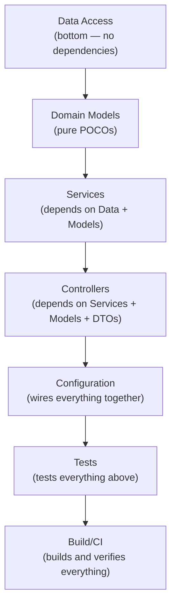

# 02 — Repository Analysis

**How to analyze a source codebase to produce structured catalogs and a database schema.**

---

## Prerequisites

- [01-requirement-understanding.md](01-requirement-understanding.md) complete
- Read access to the source repository

---

## Method

Analysis follows the dependency graph bottom-up, matching how the code is layered:

```
Data Access     (bottom — no dependencies)
    │
Domain Models   (pure POCOs, no dependencies)
    │
Services        (depends on Data + Models)
    │
Controllers     (depends on Services + Models + DTOs)
    │
Configuration   (wires everything together)
    │
Tests           (tests everything above)
    │
Build/CI        (builds and verifies everything)
```



For each layer, produce a structured catalog section in the Repository Understanding Document.

---

## Schema Reverse-Engineering

When no database migration scripts exist, the schema is inferred from repository SQL queries:

1. Read every `SELECT`, `INSERT`, `UPDATE`, `DELETE` in repositories
2. Extract table names, column names, types (inferred from language types and SQL parameters)
3. Infer constraints (NULL/NOT NULL from INSERT behavior, FKs from JOIN queries)
4. Produce a Flyway baseline script (`V1__baseline.sql`) that recreates the schema
5. Verify by running the new backend against a fresh database created from the script

---

## Analysis Output

| Catalog | Content | Example |
|---------|---------|---------|
| Solution Topology | Projects, dependency graph, target frameworks | `Api → Core, Services; Services → Core, Data; Data → Core` |
| Entry Point | DI registrations, middleware pipeline, config | Scoped registrations for 6 repos, 5 services, JWT config |
| Domain Model | Entities, fields, types, relationships | `Product(Id, Name, Price, CategoryId, IsActive, ...)` |
| DTO Catalog | DTOs, field names, JSON serialization behavior | `ProductDetailDto` with nested `ProductImageDto`, `ProductVariantDto` |
| Data Access Map | All SQL queries, tables, columns, parameters | `SELECT * FROM Product WHERE IsActive = 1 ORDER BY Name` |
| Business Logic | Services, key behaviors, calculations | GST = (subTotal + shipping) × 0.18, banker's rounding |
| API Surface | Controllers, routes, methods, auth, status codes | `GET /api/products` → 200, `PagedResult<ProductListResponseDto>` |
| Security | Auth mechanism, token format, claims, validation | HS256, `sub`/`customer_id`/`email`/`jti`, 1h expiry, ClockSkew=0 |
| Test Inventory | Test classes, test count, coverage | 5 classes, 29 tests (.NET), mock-based unit tests |
| Build/CI | Commands, workflows, Docker, Makefile | `dotnet build`, `dotnet test`, CI workflows, Dockerfile |

---

## Output Document

The analysis produces a single **Repository Understanding Document** (typically 300-400 lines) that serves as:
- The input to [03-architecture-understanding.md](03-architecture-understanding.md)
- The reference for all parity constraints in [07-prompt-generation.md](07-prompt-generation.md)
- The source for the Flyway baseline script used in implementation