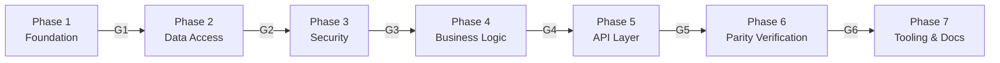

# 04 — Planning

**How to produce planning artifacts and define phases with gates before any code is written.**

---

## Prerequisites

- [03-architecture-understanding.md](03-architecture-understanding.md) complete
- ADRs authored

---

## Principle

> The entire migration is planned before implementation begins. All planning artifacts are produced first. Implementation tasks read these artifacts as their input context.

---

## Planning Artifacts

Ten artifacts are produced before any code:

| # | Artifact | Purpose |
|---|----------|---------|
| 1 | Repository Understanding | Complete source code analysis (from [02-repository-analysis.md](02-repository-analysis.md)) |
| 2 | Migration Summary | Goal, scope, technology mapping, parity constraints |
| 3 | Implementation Plan | Layer translation order, per-layer detail, risk register |
| 4 | Migration Phases | Dependency-ordered phases with entry/exit gates |
| 5 | Task Breakdown | Every task with ID, effort, dependencies, files touched (see [05-task-breakdown.md](05-task-breakdown.md)) |
| 6 | Task Dependencies | Dependency matrix, parallelization, critical path (see [05-task-breakdown.md](05-task-breakdown.md)) |
| 7 | AI Role Assignment | Role and reasoning tier per task (see [06-agent-orchestration.md](06-agent-orchestration.md)) |
| 8 | Task Prompts | Self-contained prompt for each task (see [07-prompt-generation.md](07-prompt-generation.md)) |
| 9 | Verification Strategy | Three verification rings, parity traps, rollback criterion (see [09-build-and-verification.md](09-build-and-verification.md)) |
| 10 | Documentation Strategy | What docs to create/update, when, by whom (see [10-documentation.md](10-documentation.md)) |

---

## Phase Template

Each phase follows this structure:

```
Phase N: [Name]
Objective: [One sentence]
Entry Criteria: [What must be true to start]
Exit Criteria (Gate GN): [Automated checks — commands with expected outputs]
Tasks: T-XXX through T-YYY
Parallelization: [Which tasks can run concurrently]
```

---

## Phase Gates

Each phase has a gate — a checkpoint that must pass before the next phase begins. Gate criteria are automated commands with expected outputs. No "looks right" checks.

| Gate | Command | Expected |
|------|---------|----------|
| G1 | `mvn compile && curl /api/health` | Build success + `{"status":"Healthy","db":1}` |
| G2 | `mvn test -Dtest='*IT'` | All integration tests pass |
| G3 | `mvn test -Dtest=SecurityTests` | Anonymous→401, valid→200 |
| G4 | `mvn test -Dtest='*ServiceTests'` | All service unit tests pass |
| G5 | `mvn test -Dtest='*ControllerTests'` | All MockMvc tests pass |
| G6 | `mvn test -Dtest='ContractTests' && npx playwright test` | Contract + E2E green |

No phase advances until its gate passes.



---

## Risk-Ordered Phase Selection

Phases are ordered from lowest risk to highest. Each phase validates infrastructure needed by the next.

| Phase | Content | Risk |
|-------|---------|------|
| 1 | Foundation (skeleton, entities, DTOs) | Low |
| 2 | Data access (repositories) | Medium |
| 3 | Security (JWT, Spring Security) | Medium |
| 4 | Business logic (services) | High |
| 5 | API layer (controllers) | Medium |
| 6 | Parity verification (contract + E2E) | High |
| 7 | Tooling and documentation | Low |

---

## Migration Strategy

### Strangler Fig Pattern (Wave 1)

A reverse proxy routes traffic between the legacy app and the modern stack. Routes are migrated one vertical slice at a time. The legacy app remains as fallback until all routes are migrated.

### Parity Migration (Wave 2)

Backend-to-backend migration. The source backend serves as the "parity oracle" — the new backend must produce identical API responses. The frontend is not modified; it serves as the integration test consumer.