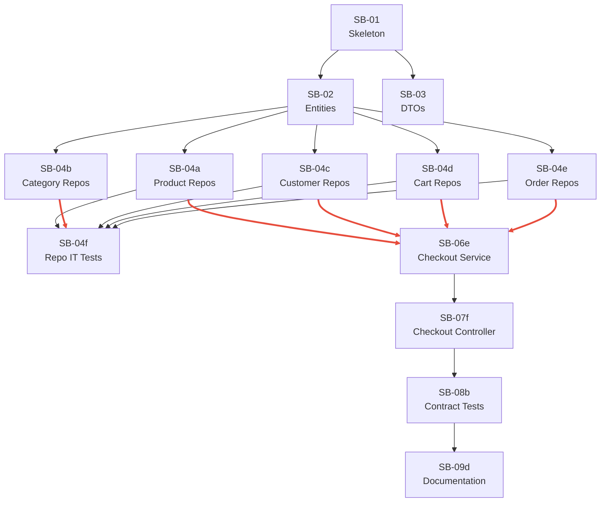

# 05 — Task Breakdown

**How to decompose phases into single-objective tasks with stable IDs and binary acceptance criteria.**

---

## Prerequisites

- [04-planning.md](04-planning.md) complete
- Phases and gates defined

---

## Decomposition Rules

- Every task solves exactly one problem
- Every task is independently verifiable
- No task contains multiple objectives
- Tasks execute sequentially by default; parallel only where the dependency graph allows
- Task IDs are stable and never reused
- Every task lists files created and modified
- Every task has binary acceptance criteria (pass/fail, no subjective checks)

---

## Task Definition Format

```
T-NNN: [Action-Oriented Title]
Description: [What and why]
Objective: [Single concrete outcome]
Inputs: [What is required to start]
Outputs: [What this task produces]
Dependencies: [Task IDs that must be complete]
Files Created: [New files]
Files Modified: [Existing files changed]
Acceptance Criteria:
  - [ ] [Binary check 1]
  - [ ] [Binary check 2]
Complexity: Trivial | Low | Medium | High | Critical
```

---

## Example: Good vs. Bad Decomposition

**Bad:** "Build the product catalog" — too large, multiple objectives, unclear verification.

**Good:** Decomposed into 17 tasks:
- T-029: Port Product domain model (copy, compile)
- T-030: Port Category domain model (copy, compile)
- T-031: Port ProductImage and ProductVariant models (copy, compile)
- T-032: Create ProductListResponseDto (define record, compile)
- T-033: Create ProductDetailDto (define record, compile)
- T-034: Create CategoryDto and PagedResult (define, compile)
- T-035: Port IProductRepository interface (copy, compile)
- ...
- T-044: Implement ProductsController (GET endpoints, return DTOs)
- T-045: Implement CategoriesController (GET endpoint, return DTOs)

Each task verified by a single command: build succeeds.

---

## Dependency Management

Every task explicitly declares its dependencies:

```
SB-01  : —                         (foundation, no deps)
SB-02  : SB-01                     (needs JPA on classpath)
SB-03  : SB-01                     (needs skeleton)
SB-04a : SB-02                     (needs entities)
SB-04d : SB-02                     (needs entities)
SB-04f : SB-04a, b, c, d, e        (needs ALL repos)
SB-06e : SB-04a, c, d, e           (needs ALL repos for checkout)
```

### Critical Path

The longest chain of dependent tasks that determines minimum project duration:

```
SB-01 → SB-02 → SB-04e → SB-06e → SB-07f → SB-08b → SB-09d
```



### Parallelization

Tasks with no mutual dependencies are dispatched concurrently:

- After skeleton (SB-01): entities (SB-02) and DTOs (SB-03) in parallel
- After entities (SB-02): all 5 repository groups (SB-04a–e) in parallel
- After exception advice (SB-07a): all 7 controllers (SB-07b–h) in parallel

---

## Output

The task breakdown feeds directly into:
- [06-agent-orchestration.md](06-agent-orchestration.md) — role assignment per task
- [07-prompt-generation.md](07-prompt-generation.md) — one prompt per task
- [11-progress-tracking.md](11-progress-tracking.md) — tracking against stable task IDs