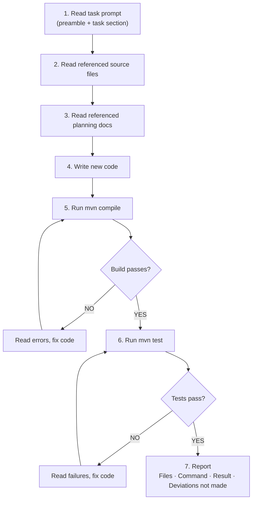

# 06 — Agent Orchestration

**How to assign tasks to AI agents, manage execution, and handle exceptions.**

---

## Prerequisites

- [05-task-breakdown.md](05-task-breakdown.md) complete
- Tasks have stable IDs and role assignments

---

## Planned Architecture (Multi-Model)

The original plan called for three specialized AI models:

| Role | Responsibility |
|------|----------------|
| Planner | Design decisions, ADRs, task decomposition, documentation |
| Orchestrator | Task queue management, dependency validation, gate enforcement |
| Implementer | Code writing, builds, tests, error fixing |

All inter-role communication routes through the Orchestrator. No direct Planner-to-Implementer communication.

---

## Actual Execution (Single-Model)

The deployment environment had only one model available. The process was adapted:

- The same agent produced all 10 planning artifacts, then executed all implementation tasks
- Planning artifacts served as the agent's own context — it read its own plans before implementing
- Gate enforcement was manual (human reviewer checked build/test output)
- The three-model role assignments were preserved as documentation for future multi-model deployments

---

## Per-Task Workflow

For each task, the agent executes:

1. Read the task prompt (preamble + task-specific section) — see [07-prompt-generation.md](07-prompt-generation.md)
2. Read referenced source files (legacy code)
3. Read referenced planning docs
4. Write new code following conventions from preamble
5. Run `mvn compile` — fix errors if any, recompile
6. Run `mvn test` — fix failures if any, retest
7. Report: files created/modified, command output, pass/fail, deviations considered but not made



---

## Exception Handling

| Scenario | Response |
|----------|----------|
| Build fails | Read errors, fix code, rebuild — repeat until success |
| Test fails | Read failures, fix code, retest — repeat until success |
| Runtime error (e.g., SQL column mismatch) | Read stack trace, identify root cause, fix mapping/config, rebuild, retest |
| Architecture question arises | Author ADR, update plan, proceed |

---

## Role Assignment for Multi-Model Deployment

When multiple models are available, assign by task type:

| Task Type | Role | Reasoning Tier |
|-----------|------|----------------|
| Project skeleton | Implementer | High |
| Entity/DTO mapping | Implementer | Medium |
| Security configuration | Implementer | High |
| Business logic porting | Implementer | Medium |
| Checkout/transaction logic | Implementer | High |
| Contract/parity tests | Implementer | High |
| Architectural decisions | Planner | High |
| ADR authoring | Planner | High |
| Task decomposition | Planner | High |
| Gate enforcement | Orchestrator | — |

---

## Task Completion Reporting

When a task completes, the agent reports:

```
TASK COMPLETION
Task ID: T-NNN
Status: COMPLETE
Files Created: [list]
Files Modified: [list]
Command: mvn test
Result: Tests run: 28, Failures: 0, Errors: 0
Deviations considered but NOT made: [list]
```

The "deviations not made" field surfaces unconscious bias toward "improving" code. See [01-requirement-understanding.md](01-requirement-understanding.md) for parity traps.