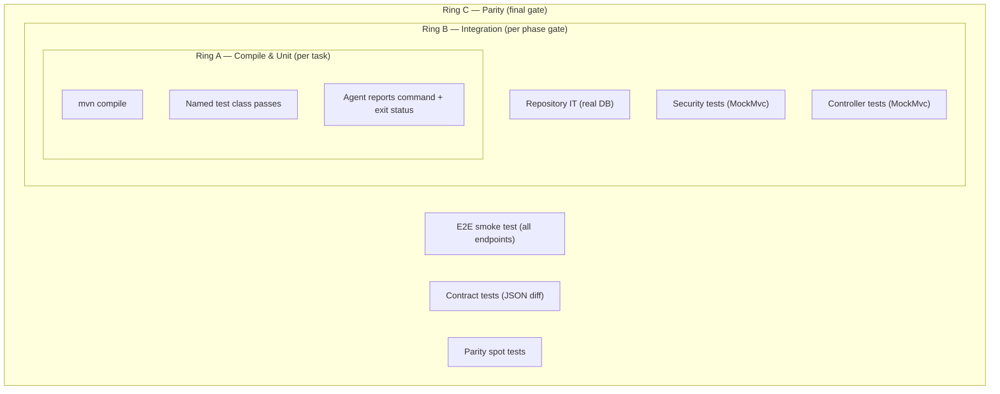

# 09 — Build and Verification

**Three verification rings, phase gates, and the self-correction loop.**

---

## Prerequisites

- [08-implementation.md](08-implementation.md) — task implementation complete
- [04-planning.md](04-planning.md) — phase gates defined

---

## Three Verification Rings

| Ring | Scope | When | What It Catches |
|------|-------|------|-----------------|
| A — Compile & Unit | Per task | Every task completion | Syntax, types, DI wiring, ported logic regressions |
| B — Integration | Per phase gate | Phase checkpoint | Repo SQL correctness, security config, controller behavior |
| C — Parity | Final gate | End of migration | Behavioral differences between old and new systems |

---

## Ring A — Per Task

Every task ends with a build/test command:
- `mvn compile` succeeds
- The task's named test class passes
- The agent reports the exact command and exit status

No task is considered complete until Ring A passes.

---

## Ring B — Per Phase Gate

| Gate | Tests | Environment |
|------|-------|-------------|
| G1 | App boots, `/api/health` returns 200 | Local SQL Server |
| G2 | Repository integration tests | H2 in-memory |
| G3 | Security tests: anonymous→401, valid→200, expired→401 | MockMvc |
| G4 | All service unit tests pass | Mockito |
| G5 | All MockMvc controller tests pass | MockMvc |

No phase advances until its gate passes. No "looks right" checks — everything is automated.

---

## Ring C — Parity Verification

The final ring proves behavioral equivalence between old and new systems:

- **End-to-end smoke test** — Start the app against the real target database. Hit every endpoint with `curl`. Verify status codes and JSON response shapes.
- **Integration tests** — `@SpringBootTest` tests covering health, products, categories, login (valid + invalid), featured products.

---

## Self-Correction

When verification fails, the agent diagnoses the error and fixes it in the same session. Three runtime issues were discovered and fixed during SQL Server integration testing in this project (see [99-case-study-dotnet-java.md](99-case-study-dotnet-java.md), Challenges section).

---

## Rollback Criterion

If a behavioral difference is found after migration:

1. **Do not patch the test to match the new system.**
2. File the discrepancy back to the owning task.
3. Re-execute that task with the discrepancy appended as an additional requirement.
4. Re-run Rings B and C for the affected phase and downstream.

---

## Verification Cadence

| Cadence | Rings | Trigger |
|---------|-------|---------|
| Per task | A | Every task completion |
| Per phase | A + B | Phase gate checkpoint |
| Final | A + B + C | End of migration |
| Post-cleanup | A + B | After repository cleanup (verify nothing broke) |