```mermaid
gantt
    title Project Timeline (Aug 5–6, 2026)
    dateFormat HH:mm
    axisFormat %H:%M

    section Wave 1 — .NET 10 + Vue SPA
    Initial commit               :w1a, 11:50, 10m
    .NET solution + YARP         :w1b, after w1a, 60m
    Vue SPA + components         :w1c, after w1b, 28m
    Repository cleanup           :w1d, after w1c, 54m

    section Wave 2 — Java Spring Boot
    Planning artifacts (10 docs) :w2a, 09:46, 44m
    SB-01–SB-09 implementation   :w2b, after w2a, 120m
    SQL Server parity fixes      :w2c, after w2b, 16m
    Repository cleanup           :w2d, after w2c, 12m
```

# 99 — Case Study: .NET to Java Migration

**Concrete metrics, timeline, challenges, and lessons from the RAW.FORM eCommerce project.**

---

## Project Summary

Modernized a legacy ASP.NET MVC 5 eCommerce application into a Java 21 + Spring Boot 3.3 + Vue 3 production system, executed in two waves across a single working day using AI agents as primary implementers.

---

## Timeline

```
Wave 1: Legacy MVC 5 → .NET 10 API + Vue  SPA          
  Initial commit                                        
  .NET solution, YARP, controllers, services             
  Vue SPA, components, stores, routing                  
  Repository cleanup (infra, scripts, docker removed)    

Wave 2: .NET 10 → Java 21 + Spring Boot 3.3              
  Planning artifacts (10 docs)                          
  SB-01 through SB-09 (implementation)                   
  SQL Server integration + parity fixes                  
  Repository cleanup (.NET removed, renamed to backend)  
```



---

## Metrics

| Metric | Value |
|--------|-------|
| Git commits | 20 |
| Planning artifacts produced | 10 documents (1,417 lines) |
| Architecture Decision Records | 7 |
| Architecture documents | 8 |
| Java source files | 66 |
| Java test files | 5 |
| Java tests passing | 28/28 (0 failures, 0 errors, 0 skipped) |
| Vue components | 23 |
| Vue views | 12 |
| Vue stores | 7 |
| Frontend unit tests | 7 spec files |
| E2E test specs | 5 (Playwright) |
| JPA entities | 9 |
| DTOs (Java records) | 16 |
| REST endpoints | 22 across 8 controllers |
| Services with interfaces | 5 |
| SQL Server tables | 9 |
| AI models used | 1 (single-model execution; multi-model was infeasible) |

---

## Test Results

| Test Suite | Tests | Status |
|------------|-------|--------|
| JwtTokenServiceTest | 3 | All pass |
| ProductsControllerTest | 4 | All pass |
| CartControllerTest | 6 | All pass |
| CheckoutServicePureTest | 9 | All pass |
| EcommerceApplicationIntegrationTest | 6 | All pass |
| **Total** | **28** | **28 pass, 0 fail** |

---

## Challenges and Resolutions

### 1. Legacy Source Read-Only

**Problem:** Original plan called for adding a JWT bridge endpoint to the legacy MVC `AccountController`. Legacy repository policy prohibited modifications.

**Resolution:** Authored ADR-004 (JWT Bridge, superseded) and ADR-006 (Native API Auth, accepted). Authentication was built natively in the new backend. The constraint led to a simpler architecture.

### 2. No Database Migration Scripts

**Problem:** No schema migration scripts existed. Schema was implicit, created manually.

**Resolution:** Reverse-engineered schema from repository SQL queries. Produced a Flyway baseline script (`V1__baseline.sql`). Verified by running the new backend against a fresh database created from the script.

### 3. Hibernate Naming Strategy Mismatch

**Problem:** Spring Boot's default `CamelCaseToUnderscoresNamingStrategy` converted `@Column(name = "IsActive")` to `is_active`. SQL Server schema uses PascalCase (`IsActive`). All queries failed with "Invalid column name 'is_active'."

**Resolution:** Set `physical-strategy: org.hibernate.boot.model.naming.PhysicalNamingStrategyStandardImpl` in all `application*.yml` files. Updated raw SQL in `CartItemRepositoryImpl` to use PascalCase column names with snake_case aliases for RowMapper compatibility.

**Discovery:** Started the app against SQL Server, hit `/api/products`, read the SQL error in the log: `Invalid column name 'is_active'. SQLState: S0001, Error: 207`.

### 4. Raw SQL in Cart Repository Using Snake_case

**Problem:** `CartItemRepositoryImpl` contained a raw JDBC SQL query using snake_case table and column names (`cart_item`, `product_id`). SQL Server tables use PascalCase (`CartItem`, `ProductId`).

**Resolution:** Rewrote the SQL to use PascalCase table/column names with explicit aliases matching the RowMapper's expected column names.

**Discovery:** Hit `/api/cart` with a valid JWT, read the error: `Invalid object name 'cart_item'. SQLState: S0002, Error: 208`.

### 5. JSON Serialization Parity

**Problem:** .NET's `System.Text.Json` serializes PascalCase properties as camelCase by default. Java's Jackson defaults to the Java field name.

**Resolution:** Configured Jackson globally: `property-naming-strategy: LOWER_CAMEL_CASE` and `default-property-inclusion: non_null`.

### 6. The `ORDER` Reserved Word

**Problem:** `Order` is a SQL and JPQL reserved word. JPA queries like `FROM Order` fail to parse.

**Resolution:** Used `@Entity(name = "EcommerceOrder")` and `@Table(name = "\"Order\"")`. All repository queries reference `EcommerceOrder`.

### 7. Money Rounding

**Problem:** .NET `decimal` uses banker's rounding. Java's `BigDecimal` defaults to `HALF_UP`. GST calculations could differ by 1 paise.

**Resolution:** Used `BigDecimal` for all money fields. Set `RoundingMode.HALF_EVEN` to match .NET. GST rate: `new BigDecimal("0.18")`.

### 8. CORS Configuration

**Problem:** Frontend on port 5174 could not access backend API on port 5001.

**Resolution:** Externalized CORS origins to `cors.allowed-origins` property. Default: `http://localhost:5173,http://localhost:5174`.

### 9. DataSeeder Profile Mismatch

**Problem:** "No products found" — `DataSeeder` was annotated `@Profile("dev")` but default profile was not set to `dev`.

**Resolution:** Added `spring.profiles.default: dev` to `application.yml`. Later moved `DataSeeder` to `@Profile("test")` when switching to SQL Server.

---

## Lessons Learned

### What Worked

| Practice | Result |
|----------|--------|
| Plan everything before coding | Zero rework; every task had clear inputs/outputs |
| Parity constraints in every prompt | Prevented "improvements" that would break parity |
| Three verification rings | Caught issues at the right level (unit, integration, parity) |
| Phase gates | Prevented building on broken foundations |
| ADR documentation | Trapped decisions and rationale for future reference |
| Schema reverse-engineering | Made the project self-bootstrapping |
| "Report what you didn't do" rule | Surfaced unconscious bias toward improving code |

### What to Improve

| Issue | Impact | Improvement |
|-------|--------|-------------|
| Single-model execution | Slower than parallel; no role separation | Deploy multi-model orchestration when available |
| Testcontainers not used | Repository IT used H2 instead of real SQL Server | Add Testcontainers for SQL Server in repository tests |
| Contract tests not automated | Required manual cURL verification | Automate contract capture by running both backends |
| SQL Server integration tested late | Naming strategy and raw SQL issues found at E2E | Test against target database earlier in the pipeline |
| Documentation updated in batch | Some docs drifted during implementation | Enforce doc-updates-per-task more strictly |

### Counterintuitive Findings

1. **"Fixing" bugs during migration is itself a bug.** Every improvement breaks parity. The agent must be told what not to fix.
2. **The code is a better spec than any document.** Requirements documents drift; code is always accurate to what the system does.
3. **Constraints lead to better architecture.** The "legacy is read-only" constraint forced native auth, which was simpler than the bridge.
4. **Testing is the migration.** If tests prove parity, the migration is done. Manual verification is insufficient.
5. **Documentation is an input, not an output.** Planning docs were read by every implementation task. Without them, every task starts from scratch.
